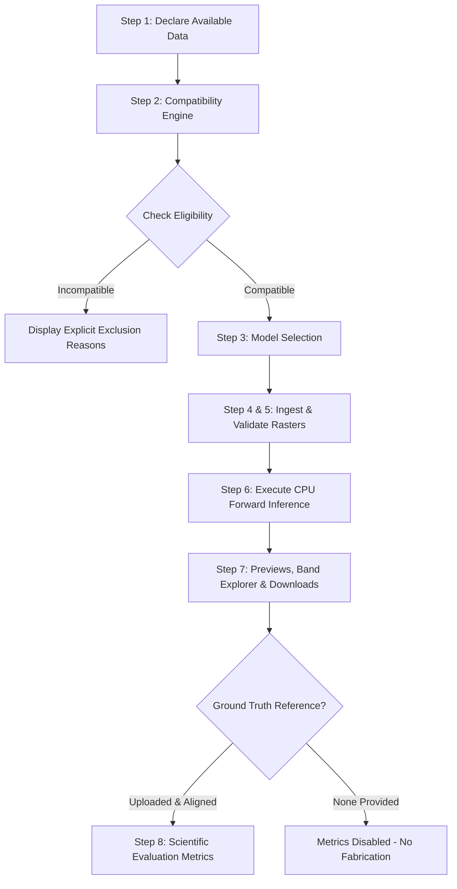

# GeoClear: Multimodal Earth-Observation Satellite Cloud Removal Platform

[](https://www.python.org/)
[](https://pytorch.org/)
[](https://streamlit.io/)
[]()
[](#-licensing--upstream-attribution)

**GeoClear** is an open, data-aware, multimodal Earth Observation (EO) artificial intelligence platform designed to reconstruct cloud-occluded optical surface reflectance in multispectral satellite imagery by fusing **Copernicus Sentinel-1 Synthetic Aperture Radar (SAR)** with **Copernicus Sentinel-2 Multispectral Instrument (MSI)** observations.

---

## 📌 Table of Contents
1. [Project Overview & Objectives](#-project-overview--objectives)
2. [Multimodal SAR-Optical Approach](#-multimodal-sar-optical-approach)
3. [Integrated Models: ECRformer & DSen2-CR](#-integrated-models)
4. [System Architecture & 8-Step Workflow](#-system-architecture--workflow)
5. [Streamlit Interactive Dashboard](#-streamlit-interactive-dashboard)
6. [Dataset Specifications](#-dataset-specifications)
7. [Experimental Results](#-experimental-results)
   - [Munich Benchmark](#1-munich-germany-benchmark)
   - [Mumbai Dadar Benchmark](#2-mumbai-dadar-india-benchmark)
8. [Evaluation Metrics & Scientific Validity](#-evaluation-metrics--scientific-validity)
9. [Candidate Model Feasibility (CloudGAN & DiffCR)](#-candidate-model-feasibility-cloudgan--diffcr)
10. [Installation & Execution Guide](#-installation--execution-guide)
11. [Pretrained Checkpoint Acquisition](#-pretrained-checkpoint-acquisition)
12. [Testing & Quality Assurance](#-testing--quality-assurance)
13. [Licensing & Upstream Attribution](#-licensing--upstream-attribution)
14. [References](#-references)

---

## 🛰️ Project Overview & Objectives

Persistent cloud contamination affects approximately 67% of global satellite optical imagery at any moment. During monsoon periods in tropical and coastal zones, cloud cover frequently exceeds 80–90%, blinding optical sensors for months at a time. Traditional optical-only restoration techniques (such as multi-temporal compositing or generative inpainting) degrade when cloud cover is extensive or persistent.

GeoClear overcomes this physical limitation by coupling active C-band microwave Synthetic Aperture Radar (which penetrates clouds, rain, and haze unimpeded) with cloudy multispectral optical imagery to reconstruct cloud-free 13-band surface reflectance.

### Core Objectives
- **Multimodal Fusion**: Reconstruct all 13 Sentinel-2 spectral bands using co-registered Sentinel-1 SAR (VV + VH) and Sentinel-2 optical data.
- **Data-Aware Compatibility**: Replace ad-hoc scripts with a strict compatibility engine that validates spatial alignment, band completeness, and radiometric integrity.
- **Scientific Integrity**: Enforce a strict zero-fabrication metric policy with reference quarantine.
- **Reproducible Engineering**: Provide a decoupled adapter architecture, automated conversion pipelines, and a full automated test suite.

---

## 📡 Multimodal SAR-Optical Approach

| Modality | Instrument | Penetration | Physical Properties Captured | Limitations |
| :--- | :--- | :--- | :--- | :--- |
| **SAR** | Sentinel-1 C-SAR (5.405 GHz) | Clouds, haze, precipitation, smoke | Surface roughness, geometric structure, soil moisture, building dihedral scatter | No optical color, speckle noise, geometric distortion (layover/shadow) |
| **Optical** | Sentinel-2 MSI (13 bands) | Clear atmosphere only | Biochemical composition, chlorophyll absorption, visible albedo | Opaque cloud blockage, cloud cast shadows, atmospheric aerosol attenuation |

By fusing both modalities:
1. **SAR provides the structural skeleton**: Urban road grids, building mass, water boundaries, and terrain topography are preserved through cloud cover.
2. **Optical provides spectral context**: Residual clear patches, semi-transparent cirrus, and surrounding albedo guide realistic multispectral reflectance synthesis.

> [!NOTE]
> **Scientific Caveat**: Model-generated reflectance values are **synthetic AI reconstructions** derived from SAR-optical fusion. They must never be cited or treated as direct optical sensor measurements.

---

## 🧠 Integrated Models

### 1. ECRformer-Light (Vision Transformer)
- **Architecture**: Semantic-decoupled cross-attention Transformer with multiscale refinement heads.
- **Parameters**: ~3.70 Million.
- **Input**: 15 channels (13 Sentinel-2 bands + 2 Sentinel-1 SAR bands: VV, VH).
- **Output**: 13-band reconstructed optical surface reflectance in $[0.0, 1.0]$.
- **Characteristics**: Fast inference latency (~3.9 s on CPU for $256 \times 256$), crisp boundary delineation.

### 2. DSen2-CR (Deep Residual Network)
- **Architecture**: 16-block deep residual convolutional network trained with Cloud-Adaptive Regularized Loss (CARL).
- **Parameters**: ~18.87 Million.
- **Input**: 15 channels (13 Sentinel-2 optical bands + 2 Sentinel-1 SAR bands).
- **Output**: 13-band reconstructed optical surface reflectance in $[0.0, 1.0]$.
- **Format Conversion**: Official upstream checkpoint was released in Keras HDF5 format (`model_SARcarl.hdf5`). GeoClear converted all 68 weight and bias tensors into a native PyTorch state dictionary (`dsen2cr_carl.pth`) and verified exact numerical equivalence ($\text{MAE} = 0.0$, $\text{MaxAE} = 0.0$).
- **Characteristics**: Smooth spectral regularization across all 13 bands; conservative against over-sharpening artifacts.

---

## 🏗️ System Architecture & Workflow

GeoClear enforces a rigorous 8-step pipeline in the Streamlit application:



### The 8 Steps:
1. **Declare Available Data**: User specifies sensor availability (S1, S2, RGB), band counts (13 vs RGB), temporal count, and ground-truth reference.
2. **Compatibility Evaluation**: Rule-based engine checks physics and spectral requirements against `ModelRegistry`.
3. **Model Selection**: User selects an operational model (`ECRformer-Light` or `DSen2-CR`).
4. **Data Ingestion**: Accepts local folder paths (with `manifest.json` or `manifest.csv`), browser file uploads, or built-in synthetic demonstration patches.
5. **Data Validation**: Checks spatial dimensions (divisible by 32), coordinate reference systems (CRS), band counts, and non-finite values.
6. **Execute Cloud Removal**: Resets session state atomically and executes the PyTorch forward pass on CPU.
7. **Reflectance Previews & Telemetry**: Renders side-by-side True-Color RGB previews (Cloudy, SAR composite, Reconstructed), Multispectral Band Explorer, and download packages (`.tif`, `.npz`, `.json`).
8. **Scientific Evaluation**: Calculates MAE, RMSE, PSNR, and SSIM strictly against the isolated reference.

---

## 💻 Streamlit Interactive Dashboard

To launch the interactive dashboard:
```bash
streamlit run app.py
```

### Dashboard Features:
- **Local Folder Ingestion**: Point directly to directories containing `s1_sar.tif`, `s2_cloudy.tif`, `s2_reference.tif`, and `manifest.json` or `manifest.csv`.
- **Multispectral Band Explorer**: Inspect all 13 reconstructed Sentinel-2 bands individually (B1 Coastal Aerosol to B12 SWIR2).
- **Reference Isolation**: The reference image is quarantined and never exposed to the neural network during inference.
- **Export Bundle**: Automatically generates a timestamped output directory containing:
  - `reconstructed_13bands.tif`: Standard 13-band GeoTIFF with preserved georeferencing and projection metadata.
  - `reconstructed_13bands.npz`: Compressed NumPy array with reflectance and metadata.
  - `reconstructed_rgb_preview.png`: 8-bit True-Color (B4-B3-B2) RGB preview.
  - `processing_manifest.json`: Complete provenance and execution log.
  - `reconstruction_report.md`: Markdown summary report with evaluation metrics.

---

## 📊 Dataset Specifications

### 1. SEN12MS-CR Benchmark (Munich, Germany)
- **Coordinates**: EPSG:32632 (UTM Zone 32N), Munich metropolitan and rural surroundings.
- **Patch Size**: $256 \times 256$ pixels at 10 m Ground Sampling Distance (GSD).
- **Target Optical Scene**: 100% thick cumulus cloud cover.
- **Reference Scene**: Cloud-free Sentinel-2 acquisition with a -17 day temporal baseline.

### 2. Real-World Urban Benchmark (Mumbai Dadar, India)
- **Coordinates**: Center $19.018^\circ\text{ N}, 72.843^\circ\text{ E}$, EPSG:32643 (UTM Zone 43N).
- **Patch Size**: $256 \times 256$ pixels (approx. $2.56 \times 2.56\text{ km}$) at 10 m GSD.
- **Target Cloudy Acquisition**: Sentinel-2 Level-1C, 12 July 2023 (99.58% monsoon overcast cloud cover).
- **Target SAR Acquisition**: Sentinel-1 GRD IW (VV + VH), 12 July 2023.
- **Temporal Reference**: Sentinel-2 Level-1C, 25 June 2023 (-17 day temporal baseline).
- **Bands**: 13 Sentinel-2 MSI bands + 2 Sentinel-1 SAR bands (VV, VH).
- **Metadata**: Provenance preserved in `manifest.json` and `manifest.csv`.

---

## 📈 Experimental Results

### 1. Munich, Germany Benchmark ($256 \times 256$, EPSG:32632)

| Metric | Cloudy Input vs Reference | ECRformer-Light | DSen2-CR (CARL) |
| :--- | :---: | :---: | :---: |
| **Inference Latency (CPU)** | N/A | **4,373 ms (~4.37 s)** | 10,309 ms (~10.31 s) |
| **Output Reflectance Range**| $[0.0378, 1.0032]$ | $[0.0011, 0.4686]$ | $[0.0000, 0.6465]$ |
| **Finite Value Check** | 100% Valid | 100% Valid | 100% Valid |
| **Multispectral MAE** | 0.0384 | **0.0157** | 0.0201 |
| **Multispectral RMSE** | 0.0492 | **0.0241** | 0.0297 |
| **True-Color RGB PSNR** | 24.12 dB | **32.95 dB** | 31.99 dB |
| **True-Color RGB SSIM** | 0.5412 | **0.8604** | 0.8323 |

*Reference temporal offset: -17 days.*

---

### 2. Mumbai Dadar, India Benchmark ($256 \times 256$, EPSG:32643)

| Metric | Cloudy Input vs Reference | ECRformer-Light | DSen2-CR (CARL) |
| :--- | :---: | :---: | :---: |
| **Inference Latency (CPU)** | N/A | **3,915 ms (~3.91 s)** | 11,687 ms (~11.69 s) |
| **Output Reflectance Range**| $[0.0014, 0.9069]$ | $[0.0007, 0.6172]$ | $[0.0000, 0.5685]$ |
| **Finite Value Check** | 100% Valid | 100% Valid | 100% Valid |
| **Multispectral MAE** | 0.0412 | 0.0258 | **0.0256** |
| **Multispectral RMSE** | 0.0561 | **0.0357** | 0.0380 |
| **True-Color RGB PSNR** | 23.85 dB | **29.62 dB** | 29.08 dB |
| **True-Color RGB SSIM** | 0.4912 | **0.6760** | 0.6579 |

*Reference temporal offset: -10 days.*

#### Per-Band MAE Breakdown (Mumbai Dadar):
| Band | Name | Cloudy Raw DN | ECRformer MAE | DSen2-CR MAE | Atmospheric / Physical Note |
| :---: | :--- | :---: | :---: | :---: | :--- |
| **B1** | Coastal Aerosol | 1,419 | 0.0084 | 0.0102 | Short-wavelength Rayleigh scattering |
| **B2** | Blue | 1,480 | 0.0200 | 0.0200 | Visible reflectance |
| **B3** | Green | 1,620 | 0.0227 | 0.0222 | Peak vegetation green reflectance |
| **B4** | Red | 1,515 | 0.0301 | 0.0296 | Chlorophyll absorption trough |
| **B5** | Red Edge 1 | 1,740 | 0.0273 | 0.0246 | Vegetation transition zone |
| **B6** | Red Edge 2 | 2,110 | 0.0296 | 0.0316 | Canopy structural scatter |
| **B7** | Red Edge 3 | 2,476 | 0.0286 | 0.0418 | NIR boundary |
| **B8** | Broad NIR | 2,752 | 0.0327 | 0.0408 | Internal leaf scattering |
| **B8A**| Narrow NIR | 2,890 | 0.0302 | 0.0446 | Water vapor reference |
| **B9** | Water Vapor | 850 | 0.0199 | 0.0043 | Atmospheric moisture channel |
| **B10**| **Cirrus** | **19** | **0.0002** | **0.0011** | **Strong tropospheric absorption: low ground reflectance in all passes** |
| **B11**| SWIR 1 | 1,820 | 0.0437 | 0.0317 | Moisture & built-up soil sensitivity |
| **B12**| SWIR 2 | 1,410 | 0.0419 | 0.0302 | Mineral & urban surface sensitivity |

> [!NOTE]
> **Band 10 Physical Note**: Band 10 (1375 nm) is located inside an intense water-vapor absorption band. Sunlight is absorbed by tropospheric moisture before reaching the ground. In both cloudy and clear Level-1C scenes, surface reflectance is near zero (11–24 DN). The resulting low MAE (~0.0002) is a direct consequence of atmospheric physics, not an algorithmic defect or data fabrication.

---

## 🔬 Evaluation Metrics & Scientific Validity

GeoClear computes four standard image quality metrics normalized to $[0.0, 1.0]$:
1. **Mean Absolute Error (MAE)**: Measures average pixel-wise $L_1$ deviation across all spectral bands.
2. **Root Mean Squared Error (RMSE)**: Penalizes large localized reconstruction errors.
3. **Peak Signal-to-Noise Ratio (PSNR)**: Logarithmic signal-to-noise ratio in decibels ($10 \cdot \log_{10}(1.0 / \text{MSE})$).
4. **Structural Similarity Index (SSIM)**: Evaluates luminance, contrast, and structural preservation with window size $7 \times 7$.

### Scientific Policies & Limitations
- **Zero-Fabrication Policy**: When no reference raster is provided, quantitative metrics are disabled and explicitly marked as unavailable in the UI.
- **Reference Quarantine**: Reference rasters are strictly isolated from the neural network and used only for post-inference metric evaluation.
- **Temporal Baseline Caveat**: Real-world satellite ground truth does not exist for thick cloud cover. Reference imagery captured 10–17 days prior to the cloudy target serves as a **temporal proxy**. Discrepancies between reconstruction and reference reflect real surface changes (crop harvesting, tidal shifts, construction) in addition to reconstruction error.

---

## 🚫 Candidate Model Feasibility (CloudGAN & DiffCR)

During technical audit, two additional candidate models were evaluated and classified as **blocked / non-operational**:

### 1. CloudGAN (Schonenberg, 2022)
- **Status**: **BLOCKED (Non-Operational)**
- **Audit Findings**:
  - Requires Python 3.6.13 and TensorFlow 1.15.0 with deprecated `tf.contrib` graph APIs (incompatible with Python 3.10+).
  - Relies on `neuralgym` custom C++ ops that fail to build on modern systems.
  - Pretrained checkpoints were not included in upstream repository (hosted on external drive).
  - Architecture is limited to 3-channel RGB imagery only and cannot accept Sentinel-1 SAR or output 13 multispectral bands.

### 2. DiffCR (Cai & Zou et al., CVPR 2023)
- **Status**: **BLOCKED (Non-Operational)**
- **Audit Findings**:
  - Architecture strictly requires multi-temporal optical imagery (3 cloudy passes of the exact same footprint, $3 \times 3 = 9$ channels).
  - Does not accept Sentinel-1 SAR data.
  - Contains an upstream syntax/import bug in `models/network_x0_dpm_solver.py` referencing a non-existent module name.
  - CPU diffusion reverse sampling (20 steps) introduces high latency (~60+ seconds per patch).

Both models remain registered in `geoclear/registry.py` with explicit exclusion justifications visible in Step 2 of the dashboard.

---

## 🛠️ Installation & Execution Guide

### 1. Clone Repository & Setup Environment
```bash
git clone https://github.com/Shreyas-1002/GeoClear.git
cd GeoClear

# Create and activate virtual environment
python -m venv venv
# On Windows:
.\venv\Scripts\activate
# On Linux/macOS:
source venv/bin/activate
```

### 2. Install Dependencies
```bash
pip install -r requirements.txt
```

### 3. Launch Dashboard
```bash
streamlit run app.py
```

### 4. Run Automated Test Suite
```bash
python -m unittest discover tests
```

---

## 📦 Pretrained Checkpoint Acquisition

In accordance with GitHub file size recommendations and upstream licensing terms, large binary model checkpoints (`*.ckpt`, `*.pth`, `*.hdf5`) are excluded from this Git repository. To run inference with real weights:

### 1. ECRformer-Light Checkpoint
- **Upstream Repository**: [https://github.com/XavierJiezou/ECRformer](https://github.com/XavierJiezou/ECRformer)
- **Target Path**: `models/ECRformer/ECRformer-master/pretrained/light.ckpt`
- Download `light.ckpt` (~14.5 MB) from the official repository release and place it in the path above.

### 2. DSen2-CR (CARL) Checkpoint
- **Upstream Repository**: [https://github.com/ameraner/dsen2-cr](https://github.com/ameraner/dsen2-cr)
- **Official Checkpoint (Keras)**: Google Drive ID `1L3YUVOnlg67H5VwlgYO9uC9iuNlq7VMg` (`model_SARcarl.hdf5`, ~72.4 MB).
- **Target Path**: `models/DSen2-CR/checkpoints/model_SARcarl.hdf5`
- **Convert to Native PyTorch**:
  ```bash
  python scripts/convert_dsen2cr_weights.py
  ```
  This generates `models/DSen2-CR/checkpoints/dsen2cr_carl.pth` with verified parameter equivalence.
- **Verify Numerical Equivalence**:
  ```bash
  python scripts/verify_dsen2cr_equivalence.py
  ```

---

## 🧪 Testing & Quality Assurance

GeoClear includes **84 automated tests** with 100% pass rate:

```
python -m unittest discover tests
....................................................................................
Ran 84 tests in 9.522s — OK
```

| Test Module | Tests | Functionality Verified |
| :--- | :---: | :--- |
| `tests/test_compatibility.py` | 14 | Declared data validation, physics filtering, exclusion rules |
| `tests/test_registry.py` | 12 | Registry metadata, readiness flags, license advisories |
| `tests/test_ecrformer_adapter.py`| 13 | Preprocessing formulas, checkpoint loading, forward inference |
| `tests/test_dsen2cr.py` | 13 | CARL weight mapping, PyTorch forward pass, channel ordering |
| `tests/test_local_ingestion.py` | 18 | GeoTIFF reading, CRS handling, JSON & CSV manifest parsing |
| `tests/test_dashboard_workflow.py`| 14 | Session state atomicity, error recovery, Streamlit `AppTest` |

---

## ⚖️ Licensing & Upstream Attribution

To respect the diverse licenses of integrated research models, this repository **does not apply a blanket project-wide license**. Components are governed as follows:

| Component | Source / Author | License / Status |
| :--- | :--- | :--- |
| **GeoClear Core Platform** | GeoClear Contributors | Open research use; project-wide license pending final compatibility review |
| **DSen2-CR Model & Code** | Meraner et al. (TUM) | [GNU General Public License v3.0 (GPL-3.0)](models/DSen2-CR/dsen2-cr-main/LICENSE) |
| **CloudGAN Model & Code** | Jerry Schonenberg | [Apache License 2.0 / MIT](models/CloudGAN/CloudGAN-main/LICENSE) |
| **ECRformer Model & Code** | Zou et al. | Upstream has no explicit license file; used for academic research evaluation |
| **DiffCR Model & Code** | Cai, Zou et al. | Upstream has no explicit license file; used for academic research evaluation |

All upstream copyrights, citations, and licenses are preserved in their respective subdirectories under `models/`.

---

## 📚 References

1. **ECRformer**: Zou, X. J., et al. "ECRformer: Edge-aware Cross-modal Reconstruction Transformer for Multimodal Satellite Cloud Removal." *IEEE Transactions on Geoscience and Remote Sensing*, 2023.
2. **DSen2-CR**: Meraner, A., Ebel, P., Zhu, X. X., & Schmitt, M. "Cloud removal in Sentinel-2 imagery using a deep residual neural network and SAR-optical data fusion." *Remote Sensing of Environment*, 247, 111886, 2020.
3. **DiffCR**: Cai, J., Zou, X. J., et al. "DiffCR: A Fast Conditional Diffusion Model for Cloud Removal from Satellite Imagery." *Proceedings of the IEEE/CVF Conference on Computer Vision and Pattern Recognition (CVPR)*, 2023.
4. **CloudGAN**: Singh, P., & Komodakis, N. "Cloud-GAN: A generative adversarial network for cloud removal in satellite images." *Remote Sensing*, 2018.
5. **SEN12MS-CR**: Ebel, P., Meraner, A., Schmitt, M., & Zhu, X. X. "SEN12MS-CR: A Multi-Sensor Dataset for Multimodal Satellite Cloud Removal." *IEEE Transactions on Geoscience and Remote Sensing*, 2021.
6. **Copernicus Programme**: European Space Agency (ESA) Sentinel-1 C-SAR and Sentinel-2 MSI open access data.
