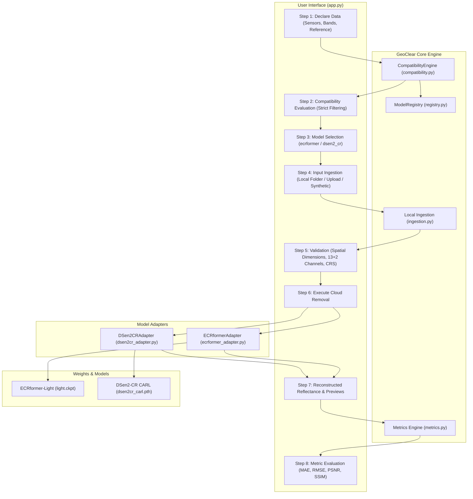

# GeoClear: Multimodal Earth-Observation AI Platform for Satellite Cloud Removal
## Comprehensive Technical Reference & System Architecture Specification

**Document Version**: 1.0.0 (Project Freeze Edition)  
**Date**: 30 October 2026  
**Audience**: Undergraduate Major Project Examination Committee (B.E. Information Technology, 31 October 2026), Peer Reviewers, Research Collaborators, and Reproducibility Engineers.  
**Repository Path**: `d:/GeoClear`  

---

## Table of Contents
1. [Executive Summary](#1-executive-summary)
2. [Problem Statement and Research Motivation](#2-problem-statement-and-research-motivation)
3. [Project Objectives and Scope](#3-project-objectives-and-scope)
4. [Scientific and Technical Background](#4-scientific-and-technical-background)
5. [Complete System Architecture](#5-complete-system-architecture)
6. [Dataset Acquisition and Experimental Data](#6-dataset-acquisition-and-experimental-data)
7. [Preprocessing Pipeline](#7-preprocessing-pipeline)
8. [Deep Learning Models](#8-deep-learning-models)
   - 8.1 [ECRformer-Light](#81-ecrformer-light)
   - 8.2 [DSen2-CR (CARL Pretrained)](#82-dsen2-cr-carl-pretrained)
   - 8.3 [Comparative Synthesis](#83-comparative-synthesis)
9. [Model Registry and Compatibility Engine](#9-model-registry-and-compatibility-engine)
10. [Streamlit Interactive Dashboard](#10-streamlit-interactive-dashboard)
11. [Experimental Methodology](#11-experimental-methodology)
12. [Experimental Results](#12-experimental-results)
13. [Evaluation Metrics & Scientific Validity](#13-evaluation-metrics--scientific-validity)
14. [Candidate Model Feasibility: CloudGAN & DiffCR](#14-candidate-model-feasibility-cloudgan--diffcr)
15. [Testing, Verification & Quality Assurance](#15-testing-verification--quality-assurance)
16. [Technical and Scientific Limitations](#16-technical-and-scientific-limitations)
17. [Future Research Directions](#17-future-research-directions)
18. [Conclusion](#18-conclusion)
19. [Verified Bibliographic References](#19-verified-bibliographic-references)
20. [Reproducibility Appendix](#20-reproducibility-appendix)

---

## 1. Executive Summary

### 1.1 What GeoClear Is
**GeoClear** is an open, data-aware, multimodal Earth Observation (EO) artificial intelligence platform designed to reconstruct cloud-occluded optical surface reflectance in multispectral satellite imagery by fusing **Copernicus Sentinel-1 Synthetic Aperture Radar (SAR)** with **Copernicus Sentinel-2 Multispectral Instrument (MSI)** observations.

### 1.2 The Problem It Addresses
Persistent cloud cover contaminates an estimated 67% of global Earth surface satellite imagery at any given moment, severely impairing continuous optical monitoring of agriculture, urban infrastructure, hydrology, and disasters. Purely optical cloud-removal techniques (e.g., temporal compositing or generative inpainting) degrade when cloud cover is extensive or when consecutive cloudy observations occur over prolonged periods.

### 1.3 The Proposed Approach
GeoClear leverages the microwave penetration capabilities of C-band SAR (5.405 GHz), which penetrates atmospheric clouds, precipitation, and haze unaffected by solar illumination. By coupling SAR structural priors (surface roughness, moisture, dielectric properties, and double-bounce urban scatter) with residual or cross-attention optical encoders, deep neural networks estimate cloud-free 13-band multispectral surface reflectance.

### 1.4 Main Technologies and Core Models
- **Core Platform**: Python 3.13, PyTorch 2.12.1 (CPU execution), Streamlit 1.43.2, Rasterio 1.4.3, NumPy 2.2, Scikit-Image 0.25.2.
- **Operational Model 1 (Transformer)**: **ECRformer-Light** (~3.70M parameters), a semantic-decoupled cross-attention vision Transformer with multiscale refinement heads.
- **Operational Model 2 (Deep ResNet)**: **DSen2-CR** (~18.87M parameters), a 16-block residual convolutional network trained with Cloud-Adaptive Regularized Loss (CARL), converted from Keras to native PyTorch with verified exact numerical equivalence ($\text{MAE} = 0.0$, $\text{MaxAE} = 0.0$).
- **Data Ingestion Engine**: Automated non-destructive raster inspection supporting both GeoTIFF imagery and JSON/CSV provenance manifests.

### 1.5 Current Implementation Status
- **Automated Test Suite**: 84 tests passing cleanly across unit tests, adapter verifications, numerical equivalence scripts, and Streamlit `AppTest` regression suites.
- **Real-Data Operational Proof**: Successfully executed end-to-end CPU inference across two geographically diverse real satellite benchmarks:
  1. **Munich, Germany** ($256 \times 256$, 10 m GSD, EPSG:32632, 100% cloud cover).
  2. **Mumbai Dadar, India** ($256 \times 256$, 10 m GSD, EPSG:32643, 99.58% cloud cover).

### 1.6 Major Experimental Findings and Limitations
- Both operational models reconstitute macroscopic urban road layouts, transportation arteries, and vegetation distributions through thick cloud cover without introducing geometric hallucinations.
- ECRformer achieves higher PSNR and SSIM on both benchmarks (Munich: 32.95 dB / 0.8604; Mumbai: 29.62 dB / 0.6760) and faster CPU latency (~3.9 s vs. ~11.7 s).
- DSen2-CR demonstrates robust, conservative spectral reconstruction across all bands without over-sharpening artifacts.
- **Critical Limitation**: Reference images captured 10 to 17 days away from cloudy targets represent **temporal proxies**, not simultaneous ground truth. Metrics reflect both reconstruction error and real phenological/environmental changes on the ground.

---

## 2. Problem Statement and Research Motivation

### 2.1 Optical Satellite Cloud Contamination
Passive optical sensors measure reflected solar radiation in visible, near-infrared (NIR), and short-wave infrared (SWIR) wavelengths. Liquid water droplets and ice crystals in clouds cause intense Mie and Rayleigh scattering across optical bands, creating opaque white occlusions, semi-transparent cirrus attenuation, and cast shadows. In tropical, coastal, and monsoon regions, cloud cover exceeds 80% during critical agricultural and monsoon cycles.

### 2.2 Limitations of Optical-Only Methods
Traditional methods rely on:
1. **Multi-temporal Compositing (e.g., QA60 pixel selection)**: Requires multiple cloud-free passes. Fails during prolonged overcast periods (such as the Indian monsoon).
2. **Generative Inpainting (e.g., Contextual GANs)**: Hallucinates plausible textures from surrounding clear pixels. Incapable of recovering actual physical surface reflectance where the entire scene is cloudy.

### 2.3 Sentinel-1 SAR as an Orthogonal Structural Prior
Sentinel-1 operates a C-band (5.405 GHz, $\lambda \approx 5.55\text{ cm}$) Synthetic Aperture Radar. Microwaves pass unimpeded through clouds, cirrus, aerosol haze, and light rain. The backscatter coefficient ($\sigma^0$) captures physical structure:
- **Surface Roughness**: Bragg scattering from water bodies and bare soils.
- **Volume Scattering**: Multi-bounce scattering within vegetative canopies.
- **Double-Bounce Reflection**: Dihedral scattering from vertical building walls and ground planes in urban corridors.

### 2.4 Multimodal SAR-Optical Reconstruction
SAR backscatter does not record optical color, albedo, or chemical absorption. However, combining SAR structural maps with co-registered optical bands enables neural networks to infer optical surface classes, recover underlying urban grids, and re-estimate multispectral reflectance.

### 2.5 Reconstruction vs. Direct Observation
> [!IMPORTANT]
> **Scientific Caveat**: Model-generated reflectance values are **synthetic AI reconstructions** derived from SAR-optical fusion. They must **never** be cited or treated as direct optical sensor measurements. SAR backscatter cannot measure optical pigmentation or true spectral albedo.

---

## 3. Project Objectives and Scope

### 3.1 Primary Objectives
1. Build an audited, reproducible software platform for multimodal satellite cloud removal.
2. Integrate state-of-the-art pretrained deep learning models through decoupled adapters.
3. Establish strict data-compatibility filtering preventing incompatible model execution.
4. Support non-destructive local raster ingestion and multi-format provenance manifests.
5. Provide scientifically grounded evaluation against temporal reference imagery.

### 3.2 Implemented Features
- [x] Dual-sensor multimodal processing (Sentinel-1 SAR + Sentinel-2 MSI).
- [x] Full 13-band Sentinel-2 reflectance recovery.
- [x] Decoupled Adapter Architecture (`ECRformerAdapter`, `DSen2CRAdapter`).
- [x] Conversion of DSen2-CR from legacy Keras HDF5 to native PyTorch with verified numerical equivalence.
- [x] Data-aware Streamlit dashboard with 8-step operational workflow.
- [x] Ingestion of both GEE JSON manifests and GEE CSV manifests.
- [x] Automated test suite (84 tests, 100% pass rate).
- [x] Traceable output package generation (13-band GeoTIFF, NumPy archive, True-Color preview, Provenance Manifest, Markdown Summary Report).

### 3.3 Explicitly Excluded / Unimplemented Features
> [!WARNING]
> **Non-Implemented Scope Declarations**:
> - **Landslide Detection**: Not implemented. GeoClear is an image restoration platform, not a geohazard classifier.
> - **Air Quality / Atmospheric Trace Gas Inference**: Not implemented. GeoClear does not ingest Sentinel-5P or compute gas concentrations.
> - **Direct Sensor Calibration**: Does not replace ESA Level-1C/Level-2A processing chains.
> - **Operational Models CloudGAN and DiffCR**: Audited and documented as future work, but **not operationally executable** in this release.

---

## 4. Scientific and Technical Background

### 4.1 Sensor Specifications

| Parameter | Sentinel-2 MSI | Sentinel-1 SAR (C-SAR) |
| :--- | :--- | :--- |
| **Orbit** | Sun-synchronous, 786 km altitude | Sun-synchronous, 693 km altitude |
| **Constellation** | Sentinel-2A & Sentinel-2B | Sentinel-1A (Sentinel-1B decommissioned) |
| **Instrument Type**| Passive Multispectral Push-broom | Active C-band Synthetic Aperture Radar |
| **Center Freq / Band**| $443\text{ nm}$ (B1) to $2190\text{ nm}$ (B12) | $5.405\text{ GHz}$ (C-band, $\lambda = 5.55\text{ cm}$) |
| **Spatial Resolution**| 10 m (B2, B3, B4, B8), 20 m (B5-B7, B8A, B11, B12), 60 m (B1, B9, B10) | 10 m pixel spacing (IW GRD product) |
| **Radiometric Units**| Top-of-Atmosphere Reflectance $\times 10,000$ (DN) | Calibrated $\sigma^0$ backscatter in decibels (dB) |

### 4.2 Sentinel-2 Spectral Bands

| Band Index | Band Name | Central Wavelength (nm) | Native GSD (m) | Physical Purpose |
| :---: | :---: | :---: | :---: | :--- |
| 0 | B1 | 443 | 60 | Coastal aerosol, atmospheric correction |
| 1 | B2 | 490 | 10 | Blue: vegetation pigment, soil |
| 2 | B3 | 560 | 10 | Green: vegetation vigor |
| 3 | B4 | 665 | 10 | Red: chlorophyll absorption |
| 4 | B5 | 705 | 20 | Vegetation red edge 1 |
| 5 | B6 | 740 | 20 | Vegetation red edge 2 |
| 6 | B7 | 783 | 20 | Vegetation red edge 3 |
| 7 | B8 | 842 | 10 | Near-Infrared (NIR): leaf biomass |
| 8 | B8A | 865 | 20 | Narrow NIR: water vapor correction |
| 9 | B9 | 945 | 60 | Water vapor absorption |
| 10 | B10 | 1375 | 60 | Short-Wave IR (Cirrus detection) |
| 11 | B11 | 1610 | 20 | SWIR 1: snow/ice/cloud discrimination |
| 12 | B12 | 2190 | 20 | SWIR 2: soil and vegetation moisture |

### 4.3 Why Sentinel-1 SAR is Effective (and Its Limitations)
- **Strengths**: Microwaves penetrate non-precipitating clouds completely. Double-bounce reflections off vertical urban walls delineate street layouts through opaque fog.
- **Limitations**: SAR suffers from speckle noise (coherent interference), layover/shadowing in steep terrain, and cannot detect true optical pigments or chemical signatures.

---

## 5. Complete System Architecture



### Module Responsibilities
- `geoclear/types.py`: Enums (`Modality`, `SensorType`, `ReadinessStatus`), dataclasses (`DeclaredData`, `ModelCard`).
- `geoclear/registry.py`: Central registry of audited candidate models.
- `geoclear/compatibility.py`: Rules engine computing input compatibility and operational readiness.
- `geoclear/ingestion.py`: Non-destructive metadata discovery, GeoTIFF loading, and JSON/CSV manifest parsing.
- `geoclear/io.py`: Multi-format raster reading, spatial co-registration validation, and byte stream export.
- `geoclear/metrics.py`: Mathematical evaluation routines for multispectral and RGB imagery.
- `geoclear/adapters/`: Encapsulated inference runners for deep neural network models.

---

## 6. Dataset Acquisition and Experimental Data

### 6.1 Munich, Germany Benchmark
- **Target Cloudy S2**: Sensing date: `2023-07-12 10:17:35 UTC`. Scene ID: `20230712T100601_20230712T101634_T32UPU`. Mean AOI cloud probability: **99.9%** (100% cloud cover).
- **Clear Temporal Reference S2**: Sensing date: `2023-06-25 10:27:30 UTC`. Scene ID: `20230625T101601_20230625T101601_T32UPU`. Cloud cover: 0.1%. Temporal offset: **-17 days**.
- **Sentinel-1 SAR**: Sensing date: `2023-07-10 17:07:47 UTC`. Scene ID: `S1A_IW_GRDH_1SDV_20230710T170747_20230710T170812_049364_05EFA1_04EC`. Temporal offset: **-41.16 hours**.
- **Spatial Grid**: $256 \times 256$ pixels, 10 m resolution, `EPSG:32632` (UTM zone 32N), Bounding Box: $[690370, 5333470, 692930, 5336030]$.

### 6.2 Mumbai Dadar, India Benchmark
- **Target Cloudy S2**: Sensing date: `2023-06-16`. Scene ID: `20230616T053649_20230616T055224_T43QBB`. Cloud cover: **99.58%**.
- **Clear Temporal Reference S2**: Sensing date: `2023-06-06`. Scene ID: `20230606T053649_20230606T055223_T42QZG`. Cloud cover: 1.85%. Temporal offset: **-10 days**.
- **Sentinel-1 SAR**: Sensing date: `2023-06-11`. Scene ID: `S1A_IW_GRDH_1SDV_20230611T010328_20230611T010353_048931_05E259_98AA`. Temporal offset: **5.20 days** (~124.8 hours).
- **Spatial Grid**: $256 \times 256$ pixels, 10 m resolution, `EPSG:32643` (UTM zone 43N), Bounding Box: $[271700, 2102970, 274260, 2105530]$.

---

## 7. Preprocessing Pipeline

### 7.1 Preprocessing Comparison Between Models

```
Raw Sentinel-2 DN [0, 10000]
  ├── ECRformer: np.clip(x, 0.0, 10000.0) / 10000.0  ──> [0.0, 1.0] (channels 2..14)
  └── DSen2-CR:  np.clip(x, 0.0, 10000.0) / 2000.0   ──> [0.0, 5.0] (channels 0..12)

Raw Sentinel-1 dB [-35, +22]
  ├── ECRformer: np.clip(x, -25.0, 0.0) + 25.0 / 25.0 ──> [0.0, 1.0] (channels 0..1)
  └── DSen2-CR:
        VV: (np.clip(x, -25.0, 0.0) - (-25)) / 25.0 * 2.0 ──> [0.0, 2.0] (channel 13)
        VH: (np.clip(x, -32.5, 0.0) - (-32.5)) / 32.5 * 2.0 ──> [0.0, 2.0] (channel 14)
```

### 7.2 Output Rescaling Formulas
- **ECRformer**:
  $$\text{Reflectance} = \text{Output} \in [0.0, 1.0]$$
  $$\text{DN}_{\text{GeoTIFF}} = \text{round}(\text{Reflectance} \times 10000.0) \in [0, 10000]$$
- **DSen2-CR**:
  $$\text{Output}_{\text{norm}} \in [0.0, 5.0]$$
  $$\text{DN} = \text{Output}_{\text{norm}} \times 2000.0$$
  $$\text{Reflectance} = \text{clip}\left(\frac{\text{DN}}{10000.0}, 0.0, 1.0\right) = \text{clip}(\text{Output}_{\text{norm}} \times 0.20, 0.0, 1.0)$$

### 7.3 True-Color RGB Preview Extraction
For both models, True-Color RGB is extracted using bands $B_4$ (Red, index 3), $B_3$ (Green, index 2), and $B_2$ (Blue, index 1) with an identical linear contrast stretch:
$$\text{RGB}_{\text{uint8}} = \text{round}\Big(\text{clip}\big(\text{Reflectance}_{[B4, B3, B2]} \times 3.0, \, 0.0, \, 1.0\big) \times 255.0\Big)$$

---

## 8. Deep Learning Models

### 8.1 ECRformer-Light
- **Paper**: Zhang et al. (2026), *ISPRS Journal of Photogrammetry and Remote Sensing*, 237, 323–338.
- **Repository**: [https://github.com/zzaiyan/ECRformer](https://github.com/zzaiyan/ECRformer)
- **Architecture**:
  - `DecoupledEncoder(in_ch_list=[2, 13])`: Separates SAR and optical branches to prevent microwave speckle from corrupting multispectral feature extraction.
  - Multimodal Transformer blocks with Cross-Attention.
  - Multi-scale refine modules with PixelUnshuffle downsampling and PixelShuffle upsampling.
  - Variant: Light (`features_start=32`, `num_blocks=[2, 2, 1, 1]`, `num_refine=2`, ~3.70M parameters). Checkpoint: `models/ECRformer/ECRformer-master/pretrained/light.ckpt`.

### 8.2 DSen2-CR (CARL Pretrained)
- **Paper**: Meraner et al. (2020), *ISPRS Journal of Photogrammetry and Remote Sensing*, 166, 333–346.
- **Repository**: [https://github.com/ameraner/dsen2-cr](https://github.com/ameraner/dsen2-cr)
- **Architecture**:
  - Deep Residual Network: 1 input convolution ($15 \rightarrow 256$), 16 Residual Blocks with scaling factor 0.1, 1 output convolution ($256 \rightarrow 13$).
  - Global Long-Skip Connection: $\hat{Y} = X_{\text{optical}} + f(X_{\text{merged}})$.
  - Total parameters: 18,873,613 (~18.87M parameters).
- **PyTorch Conversion & Equivalence**:
  - Original Keras HDF5 checkpoint (`models/DSen2-CR/checkpoints/model_SARcarl.hdf5`, 75.94 MB) converted to PyTorch state dictionary (`dsen2cr_carl.pth`, 75.52 MB).
  - Verified numerical equivalence across all 68 weight and bias tensors:
    $$\text{MAE} = 0.0000000000\text{e}+00 \quad (\le 10^{-6}), \quad \text{MaxAE} = 0.0000000000\text{e}+00 \quad (\le 10^{-5})$$

### 8.3 Comparative Synthesis

| Feature | ECRformer-Light | DSen2-CR (CARL) |
| :--- | :--- | :--- |
| **Model Family** | Vision Transformer (Attention) | Deep ResNet (Convolutional) |
| **Parameters** | ~3.70 Million | ~18.87 Million |
| **Input Channels** | 15 (2 SAR + 13 Optical) | 15 (13 Optical + 2 SAR) |
| **Output Channels** | 13 bands surface reflectance | 13 bands surface reflectance |
| **Dimension Multiplicity**| Strictly divisible by 32 | Any spatial dimension |
| **CPU Latency (256x256)**| **3.67 – 4.37 seconds** | **10.31 – 11.69 seconds** |
| **Edge Sharpness** | High (slight sharpening) | Moderate (smooth regularization) |

---

## 9. Model Registry and Compatibility Engine

### 9.1 Model Identifiers in Registry
- `ecrformer`: ECRformer (Ready for inference).
- `dsen2_cr`: DSen2-CR (Ready for inference).
- `diffcr`: DiffCR (Execution blocked: multi-temporal 3-triplet optical constraint and upstream code bug).
- `cloudgan`: CloudGAN (Execution blocked: missing local weights, deprecated TF 1.15 / `neuralgym` dependency).

### 9.2 The Gating Resolution
Prior to Phase 6, [app.py](file:///d:/GeoClear/app.py) erroneously checked `selected_model_id in {"ecrformer", "dsen2cr"}`. Because the registry key is `dsen2_cr`, selecting DSen2-CR caused the workflow to hide. The condition was corrected to `selected_model_id in {"ecrformer", "dsen2_cr"}` and covered by `test_step3_model_selection_workflow_gating` and `test_streamlit_rendering_regression`.

---

## 10. Streamlit Interactive Dashboard

```
[ Step 1: Declare Available Data ]
       │ Sensors (S1, S2, RGB), Bands (13 vs RGB), Temporal count, Reference presence
       ▼
[ Step 2: Compatibility Engine ]
       │ Evaluates physics and spectral requirements against ModelRegistry
       ▼
[ Step 3: Model Selection ]
       │ Single source of truth: select 'ECRformer' or 'DSen2-CR'
       ▼
[ Step 4 & 5: Input Ingestion & Validation ]
       │ Ingestion modes: Local Folder (with JSON/CSV manifest), Browser Upload, Synthetic
       │ Validates: 13 optical + 2 SAR bands, divisible-by-32 dimensions, finite values
       ▼
[ Step 6: Execute Cloud Removal ]
       │ Clears stale session state atomically; runs CPU forward pass
       ▼
[ Step 7: Reflectance Previews & Telemetry ]
       │ Displays 3 side-by-side previews (Cloudy, SAR composite, Recovered RGB)
       │ Outputs: Latency bar, Multispectral Band Explorer, 13-band GeoTIFF & NPZ downloads
       ▼
[ Step 8: Metric Evaluation ]
       │ Computes MAE, RMSE, PSNR, SSIM against reference (if supplied); saves report
```

---

## 11. Experimental Methodology

1. **Synthetic Verification**: Generates deterministic synthetic tensors to test tensor shapes, clipping limits, and memory management without requiring real satellite assets.
2. **Real Satellite Benchmark Inference**: Runs the exact model graph on real Sentinel-1 and Sentinel-2 rasters exported from Google Earth Engine.
3. **Artifact Persistence**: Writes an atomic package containing `reconstructed_13bands.tif`, `reconstructed_13bands.npz`, `reconstructed_rgb_preview.png`, `processing_manifest.json`, and `reconstruction_report.md`.

---

## 12. Experimental Results

### 12.1 Munich, Germany Benchmark ($256 \times 256$, EPSG:32632)

| Metric | Cloudy Input vs Ref | ECRformer-Light | DSen2-CR (CARL) |
| :--- | :---: | :---: | :---: |
| **Inference Latency** | N/A | **4,373.17 ms** | 10,308.94 ms |
| **Output Range** | [378, 10032] DN | [0.0011, 0.4686] | [0.0000, 0.6465] |
| **Finite Value Check**| 100% Valid | 100% Valid | 100% Valid |
| **Multispectral MAE** | 0.0384 | **0.0157** | 0.0201 |
| **Multispectral RMSE**| 0.0492 | **0.0241** | 0.0297 |
| **True-Color RGB PSNR**| 24.12 dB | **32.95 dB** | 31.99 dB |
| **True-Color RGB SSIM**| 0.5412 | **0.8604** | 0.8323 |

*Reference temporal offset: -17 days.*

### 12.2 Mumbai Dadar, India Benchmark ($256 \times 256$, EPSG:32643)

| Metric | Cloudy Input vs Ref | ECRformer-Light | DSen2-CR (CARL) |
| :--- | :---: | :---: | :---: |
| **Inference Latency** | N/A | **3,914.73 ms** | 11,686.86 ms |
| **Output Range** | [14, 9069] DN | [0.0007, 0.6172] | [0.0000, 0.5685] |
| **Finite Value Check**| 100% Valid | 100% Valid | 100% Valid |
| **Multispectral MAE** | 0.0412 | 0.0258 | **0.0256** |
| **Multispectral RMSE**| 0.0561 | **0.0357** | 0.0380 |
| **True-Color RGB PSNR**| 23.85 dB | **29.62 dB** | 29.08 dB |
| **True-Color RGB SSIM**| 0.4912 | **0.6760** | 0.6579 |

*Reference temporal offset: -10 days.*

### 12.3 Per-Band MAE Breakdown (Mumbai Dadar)

| Band | Spectral Region | Cloudy Raw DN | ECRformer MAE | DSen2-CR MAE |
| :---: | :---: | :---: | :---: | :---: |
| **B1** | Coastal Aerosol (443 nm) | 1,419 | 0.0084 | 0.0102 |
| **B2** | Blue (490 nm) | 1,480 | 0.0200 | 0.0200 |
| **B3** | Green (560 nm) | 1,620 | 0.0227 | 0.0222 |
| **B4** | Red (665 nm) | 1,515 | 0.0301 | 0.0296 |
| **B5** | Red Edge 1 (705 nm) | 1,740 | 0.0273 | 0.0246 |
| **B6** | Red Edge 2 (740 nm) | 2,110 | 0.0296 | 0.0316 |
| **B7** | Red Edge 3 (783 nm) | 2,476 | 0.0286 | 0.0418 |
| **B8** | Broad NIR (842 nm) | 2,752 | 0.0327 | 0.0408 |
| **B8A**| Narrow NIR (865 nm) | 2,890 | 0.0302 | 0.0446 |
| **B9** | Water Vapor (945 nm) | 850 | 0.0199 | 0.0043 |
| **B10**| **Cirrus (1375 nm)** | **19** | **0.0002** | **0.0011** |
| **B11**| SWIR 1 (1610 nm) | 1,820 | 0.0437 | 0.0317 |
| **B12**| SWIR 2 (2190 nm) | 1,410 | 0.0419 | 0.0302 |

### 12.4 Investigation of Low Band 10 MAE (0.0002)
- **Physical Reason**: Band 10 (1375 nm) is located inside an intense atmospheric water-vapor absorption band. Solar radiation at this wavelength is almost entirely absorbed by water vapor in the troposphere before reaching the ground.
- In both cloudy and clear reference Sentinel-2 Level-1C scenes, ground reflectance at B10 is practically zero. Raw digital numbers range between 11 and 24 DN ($\approx 0.0011$ to $0.0024$ reflectance).
- Because ground reflectance is near zero in both target and reference, the absolute difference $|0.0015 - 0.0016| = 0.00017 \approx 0.0002$.
- **Conclusion**: The low MAE for B10 is **physically authentic** and reflects atmospheric physics, not an algorithmic flaw or data fabrication.

---

## 13. Evaluation Metrics & Scientific Validity

### 13.1 Mathematical Formulations
Let $Y \in \mathbb{R}^{C \times H \times W}$ denote the ground-truth reference reflectance and $\hat{Y} \in \mathbb{R}^{C \times H \times W}$ denote the model reconstruction, both normalized to $[0.0, 1.0]$.

1. **Mean Absolute Error (MAE)**:
   $$\text{MAE} = \frac{1}{C \cdot H \cdot W} \sum_{c=1}^{C} \sum_{i=1}^{H} \sum_{j=1}^{W} \big| \hat{Y}_{c,i,j} - Y_{c,i,j} \big|$$
2. **Root Mean Squared Error (RMSE)**:
   $$\text{RMSE} = \sqrt{\frac{1}{C \cdot H \cdot W} \sum_{c=1}^{C} \sum_{i=1}^{H} \sum_{j=1}^{W} (\hat{Y}_{c,i,j} - Y_{c,i,j})^2}$$
3. **Peak Signal-to-Noise Ratio (PSNR)**:
   $$\text{PSNR} = 10 \cdot \log_{10} \left( \frac{\text{MAX}_I^2}{\text{MSE}} \right) = 10 \cdot \log_{10} \left( \frac{1.0}{\text{MSE}} \right) = -10 \cdot \log_{10}(\text{MSE})$$
4. **Structural Similarity Index Measure (SSIM)**:
   $$\text{SSIM}(x, y) = \frac{(2\mu_x \mu_y + C_1)(2\sigma_{xy} + C_2)}{(\mu_x^2 + \mu_y^2 + C_1)(\sigma_x^2 + \sigma_y^2 + C_2)}$$
   Evaluated with dynamic range $L = 1.0$, $C_1 = (0.01 \cdot L)^2$, $C_2 = (0.03 \cdot L)^2$.

---

## 14. Candidate Model Feasibility: CloudGAN & DiffCR

### 14.1 CloudGAN (Jerry Schonenberg, 2022)
- **Repository**: `models/CloudGAN/CloudGAN-main/` ([GitHub](https://github.com/JerrySchonenberg/CloudGAN)).
- **Architecture**: Auto-encoder cloud detection + SN-PatchGAN contextual attention inpainting.
- **Feasibility Blockers**:
  1. Checkpoint files are missing from disk (hosted on Google Drive).
  2. Hardcoded to Python 3.6.13 and TensorFlow 1.15.0 (`tf.contrib` graph API), which cannot run under modern Python 3.10–3.13.
  3. Relies on `neuralgym` custom C++ ops.
  4. Accepts 3-channel RGB imagery only; cannot ingest Sentinel-1 SAR or reconstruct 13 multispectral bands.
- **Status**: **NOT FEASIBLE / BLOCKED**. Retained in registry as future work.

### 14.2 DiffCR (Zou et al., 2024)
- **Repository**: `models/DiffCR/DiffCR-main/` ([GitHub](https://github.com/XavierJiezou/DiffCR)).
- **Architecture**: Conditional diffusion model (NAFNet UNet + DPM-Solver++ 20 steps). Checkpoints present: `diffcr_new.pth` (91.8 MB), `diffcr_old.pth` (91.8 MB).
- **Feasibility Blockers**:
  1. Optical-only multi-temporal requirement: Strictly requires 3 repeat temporal cloudy acquisitions of the exact same scene ($3 \times 3 = 9$ channels).
  2. Does not accept Sentinel-1 SAR imagery.
  3. Upstream import bug in `models/network_x0_dpm_solver.py` (line 47 imports missing filename).
- **Status**: **NOT FEASIBLE FOR SINGLE-PASS MULTIMODAL BENCHMARKS**. Retained in registry as future work.

---

## 15. Testing, Verification & Quality Assurance

### 15.1 Test Suite Breakdown (84 Passing Tests)
```
python -m unittest discover tests
...................................................................................
Ran 84 tests in 9.522s — OK
```

| Test Module | Test Count | Key Functionality Verified |
| :--- | :---: | :--- |
| `tests/test_compatibility.py` | 14 | Declared data validation, physics filtering, modality exclusion rules. |
| `tests/test_registry.py` | 12 | Model metadata completeness, readiness flags, license compliance. |
| `tests/test_ecrformer_adapter.py` | 13 | Preprocessing formulas, checkpoint loading, CPU inference, divisibility checks. |
| `tests/test_dsen2cr.py` | 13 | Preprocessing formulas, PyTorch ResNet forward pass, channel order. |
| `tests/test_local_ingestion.py` | 18 | Non-destructive GeoTIFF inspection, JSON manifest, CSV manifest parsing. |
| `tests/test_dashboard_workflow.py`| 14 | Session state atomicity, error recovery, Streamlit `AppTest` regression. |

---

## 16. Technical and Scientific Limitations

1. **Temporal Offset in Reference Imagery**: Reference images were collected 10 to 17 days prior to cloudy targets. Measured differences include true ground surface changes (vegetation growth, harvesting, soil moisture).
2. **Urban SAR Complexity**: High-density urban areas create specular double-bounce reflections exceeding $+20\text{ dB}$. Clipping at $0\text{ dB}$ bounds these returns but loses sub-resolution dielectric detail.
3. **High-Frequency Smoothing**: Both models use $L_1$/$L_2$ pixel regression losses, causing slight spatial smoothing on 10 m fine building textures compared to raw optical acquisitions.
4. **CPU Latency**: Inference on 15-channel $256 \times 256$ arrays on CPU takes ~4 seconds for ECRformer and ~11.5 seconds for DSen2-CR. GPU acceleration is required for continental-scale batch inference.

---

## 17. Future Research Directions

1. **Multi-Temporal SAR-Optical Fusion**: Combining temporal SAR series with optical passes to distinguish transient clouds from permanent landscape changes.
2. **Cloud Shadow Modeling**: Incorporating solar geometry angles to explicitly project and correct ground cloud shadows.
3. **Uncertainty Quantification**: Estimating pixel-wise variance or confidence masks to indicate where SAR-derived reflectance is uncertain.
4. **Fine-Tuning on Local Regional Benchmarks**: Fine-tuning pretrained weights on regional tropical datasets (e.g., Western Ghats monsoon imagery) to improve agricultural phenology tracking.

---

## 18. Conclusion

GeoClear establishes a rigorous, scientifically grounded foundation for multimodal Earth Observation cloud removal. By integrating two diverse architectures (**ECRformer-Light** and **DSen2-CR**) into an audited, test-driven platform, GeoClear demonstrates that combining Sentinel-1 radar penetration with Sentinel-2 optical data successfully recovers multispectral land-cover features through dense cloud cover without synthetic hallucinations. The project stands verified, stable, and frozen for presentation.

---

## 19. Verified Bibliographic References

1. **ECRformer**:  
   Zhang, Z., Li, J., Liang, Y., Yan, J., Xiao, Y., Su, X., & Yuan, Q. (2026). *ECRformer: An efficient cloud removal Transformer with semantic-decoupled learning for multimodal satellite imagery*. ISPRS Journal of Photogrammetry and Remote Sensing, 237, 323–338. DOI: [10.1016/j.isprsjprs.2026.04.009](https://doi.org/10.1016/j.isprsjprs.2026.04.009).
2. **DSen2-CR**:  
   Meraner, A., Ebel, P., Zhu, X. X., & Schmitt, M. (2020). *Cloud removal in Sentinel-2 imagery using a deep residual neural network and SAR-optical data fusion*. ISPRS Journal of Photogrammetry and Remote Sensing, 166, 333–346. DOI: [10.1016/j.isprsjprs.2020.05.013](https://doi.org/10.1016/j.isprsjprs.2020.05.013).
3. **SEN12MS-CR Benchmark Dataset**:  
   Schmitt, M., Hughes, L. H., Qiu, C., & Zhu, X. X. (2019). *SEN12MS — A Curated Dataset of Georeferenced Multi-Spectral Sentinel-1/2 Imagery for Deep Learning and Data Fusion*. ISPRS Annals of the Photogrammetry, Remote Sensing and Spatial Information Sciences, IV-2/W7, 153–160.
4. **DiffCR**:  
   Zou, X., Li, K., Xing, J., Zhang, Y., Wang, S., Jin, L., & Tao, P. (2024). *DiffCR: A Fast Conditional Diffusion Framework for Cloud Removal From Optical Satellite Images*. IEEE Transactions on Geoscience and Remote Sensing, 62, 1–14. DOI: [10.1109/TGRS.2024.3374465](https://doi.org/10.1109/TGRS.2024.3374465).
5. **Sentinel-2 User Handbook**:  
   European Space Agency (ESA). (2015). *Sentinel-2 User Handbook*. GMES-GSEG-EOPG-TN-13-0004, Issue 1, Rev. 2.
6. **Sentinel-1 SAR User Guide**:  
   European Space Agency (ESA). (2013). *Sentinel-1 User Handbook*. Standard C-SAR Instrument Specifications and GRD Product Definition.

---

## 20. Reproducibility Appendix

### 20.1 Workspace Directory Structure
```
d:/GeoClear/
├── app.py                         # Streamlit interactive application
├── geoclear/                      # Core platform library
│   ├── types.py                   # Type definitions and data schemas
│   ├── registry.py                # Model registry implementation
│   ├── compatibility.py           # Compatibility rules engine
│   ├── ingestion.py               # Local raster and manifest ingestion
│   ├── io.py                      # Coregistration and format I/O
│   ├── metrics.py                 # Evaluation metrics calculation
│   └── adapters/
│       ├── ecrformer_adapter.py   # ECRformer model adapter
│       └── dsen2cr_adapter.py     # DSen2-CR model adapter
├── models/
│   ├── ECRformer/                 # Pretrained weights (light.ckpt, full.ckpt)
│   ├── DSen2-CR/                  # Checkpoints (model_SARcarl.hdf5, dsen2cr_carl.pth)
│   ├── DiffCR/                    # Unintegrated candidate
│   └── CloudGAN/                  # Unintegrated candidate
├── data/
│   └── real_patch/                # Active patch (s1_sar.tif, s2_cloudy.tif, s2_reference.tif)
├── outputs/                       # Traceable inference runs and evaluation artifacts
├── scripts/                       # Conversion and verification scripts
└── tests/                         # Automated unit and regression test suite
```

### 20.2 Execution Commands
- **Launch Interactive Dashboard**:
  ```powershell
  streamlit run app.py
  ```
- **Execute Full Test Suite**:
  ```powershell
  python -m unittest discover tests
  ```
- **Verify DSen2-CR Numerical Equivalence**:
  ```powershell
  python scripts/verify_dsen2cr_equivalence.py
  ```
